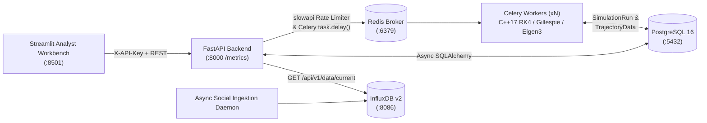

# SEIZ Disinformation Trajectory Simulator

An enterprise-grade epidemiological simulation, parameter calibration, and Trust & Safety analyst workbench for modeling the viral spread and counter-messaging containment of digital disinformation across social networks.

Built on the **SEIZ** (**S**usceptible, **E**xposed, **I**nfected, **Z**keptic) compartmental model with a **C++17 / pybind11 / Eigen3** numerical core, **FastAPI** asynchronous REST API, **Celery + Redis** distributed worker queue, **PostgreSQL + Alembic** persistence, **InfluxDB v2** live social ingestion, **Prometheus + structlog** observability, and an interactive **Streamlit + Plotly** analyst dashboard.

---

## Who This Is For

- **Trust & Safety / Integrity Analysts** evaluating how fast a breaking rumor will reach peak viral velocity ($t^*$, $\max dI/dt$) and quantifying how much platform friction or counter-messaging suppresses reach.
- **Disinformation & OSINT Researchers** fitting SEIZ epidemiological parameters $(\beta, p, l, b, \rho, \epsilon)$ directly to observed social time-series data (`t, I, Z`) and comparing narratives via the Bettencourt/Jin spreading ratio $R_{SI}$.
- **Crisis Communications Teams** running "what-if" counter-narrative interventions and 2D sensitivity heatmaps to find exact containment thresholds before narratives entrench.

---

## Mathematical Foundation (SEIZ Model)

The total network population $N = S(t) + E(t) + I(t) + Z(t)$ is strictly conserved at every time step. Derivatives are normalized by $N$ for scale invariance across network sizes:

$$\frac{dS}{dt} = -\beta \frac{S I}{N} - b \frac{S Z}{N}$$

$$\frac{dE}{dt} = (1 - p)\beta \frac{S I}{N} + (1 - l)b \frac{S Z}{N} - \rho \frac{E I}{N} - \epsilon E$$

$$\frac{dI}{dt} = p \beta \frac{S I}{N} + \rho \frac{E I}{N} + \epsilon E$$

$$\frac{dZ}{dt} = l b \frac{S Z}{N}$$

| Parameter | Domain | Operational Meaning |
| :--- | :--- | :--- |
| $\beta$ | $\ge 0$ | Contact rate between Susceptible ($S$) and Infected ($I$) users |
| $p$ | $[0, 1]$ | Probability of immediate adoption ($S \to I$) upon contact with a believer |
| $l$ | $[0, 1]$ | Probability of immediate skepticism ($S \to Z$) upon contact with a fact-checker |
| $b$ | $\ge 0$ | Contact / reach rate of Skeptics ($Z$) and counter-messaging |
| $\rho$ | $\ge 0$ | Rate at which Exposed ($E$) users adopt after additional contact with believers ($I$) |
| $\epsilon$ | $\ge 0$ | Spontaneous incubation rate ($E \to I$) |

The **SEIZ Spreading Ratio** $R_{SI} = \frac{(1-p)\beta + (1-l)b}{\rho + \epsilon}$ distinguishes direct viral spread ($R_{SI} < 1$) from incubation-dominated hesitation ($R_{SI} > 3$).

---

## System Architecture



### High-Performance C++17 Numerical Core (`src/cpp_core/`)
- **4th-Order Runge-Kutta (RK4)** single-trajectory integrator with automatic SciPy `LSODA` fallback when the compiled extension is unavailable.
- **Multi-Threaded Gillespie Exact Stochastic Solver** (`std::thread`) computing 1,000 Monte Carlo trajectories and aggregating 5th / 50th / 95th percentile confidence bands natively in C++.
- **Eigen3 SIMD Vectorized Batched RK4 Solver** evaluating 10,000 parameter combinations across 100 time steps in under 100 ms (used for 2D sensitivity heatmaps).

---

## Quickstart

### Option 1: Docker Compose (Recommended Production Stack)

1. Copy the example environment file and optionally customize `SEIZ_API_KEY`:
   ```bash
   cp .env.example .env
   ```
2. Build and launch PostgreSQL, Redis, FastAPI (with automatic `alembic upgrade head`), 2 Celery workers, and the Streamlit Analyst Workbench:
   ```bash
   docker compose up --build
   ```
3. Scale compute workers independently at any time:
   ```bash
   docker compose up --scale celery-worker=4
   ```
4. Open the interfaces:
   - **Streamlit Analyst Workbench:** `http://localhost:8501`
   - **FastAPI OpenAPI Docs:** `http://localhost:8000/docs`
   - **Prometheus Metrics:** `http://localhost:8000/metrics` (requires `X-API-Key` header)

### Option 2: Local Development (`uv` + CMake)

Requires **Python 3.12+**, **[uv](https://docs.astral.sh/uv/)**, **CMake 3.18+**, and a C++17 compiler (`g++` / `clang++` / MSVC).

```bash
# 1. Install Python dependencies (and dev tools)
uv sync

# 2. Build the C++17 pybind11 / Eigen3 extension
cmake -S . -B build -DCMAKE_BUILD_TYPE=Release
cmake --build build --config Release

# 3. Run database migrations (falls back to local SQLite if PostgreSQL is not running)
uv run alembic upgrade head

# 4. Start the FastAPI server
uv run uvicorn src.api.main:app --reload --port 8000

# 5. In a second terminal, launch the Streamlit Analyst Workbench
uv run streamlit run src/ui/app.py --server.port 8501
```

> **Local Zero-Dependency Fallback:** If PostgreSQL, Redis, or InfluxDB are not running locally, the application gracefully falls back to async SQLite (`aiosqlite`), Celery eager in-memory execution, in-memory `slowapi` rate limiting, and a local InfluxDB mirror so you can start exploring immediately.

---

## Analyst Workbench Features (`src/ui/app.py`)

1. **Trajectory Forecast:** Choose from 5 built-in disinformation presets (*Breaking Election Rumor*, *Health Misinformation*, *Rapid Fact-Check Counter-Campaign*, *Polarized Echo Chamber*, *Coordinated Bot Amplification*), run deterministic or 1,000-run stochastic Gillespie simulations, inspect $R_{SI}$, peak viral velocity ($\max dI/dt$), and inflection time ($t^*$), and download CSV trajectories or JSON intelligence reports.
2. **Global Narrative Radar (Live Worldwide Tracking):** Query live public global feeds (**GDELT 2.0 Global News**, **Bluesky ATProto**, and **Reddit**) concurrently with zero API keys required, classify multilingual posts (EN, ES, FR, DE, PT, AR + fact-checker domains) into `Infected`/`Skeptic`/`Neutral`, visualize country-by-country spread on an interactive **ISO-3 Plotly World Choropleth Map**, auto-calibrate SEIZ parameters on the live observed curve, and register narratives in the **24/7 Celery Beat Watchlist** for automated viral-velocity & $R_{SI}$ early-warning alerts.
3. **Counter-Messaging & Sensitivity Lab:** Model platform friction ($\beta$ reduction) and fact-checking interventions ($+b$, target $l$) to quantify **Infected Averted**, **Peak Velocity Reduction (%)**, and **Inflection Delay ($\Delta t^*$)**, plus run interactive **Eigen3 2D Parameter Sensitivity Heatmaps**.
4. **Calibrate to Observed Data:** Upload or paste `(t, I, Z)` CSVs, pull live minute-level series from InfluxDB, or load a sample outbreak dataset; run bounded **L-BFGS-B** parameter estimation, inspect SSE / RMSE / $R^2$ fit overlays, and load recovered parameters directly into the forecast simulator.
5. **Narrative Classifier & Run History:** Test the deterministic NLP post classifier (`Infected` / `Skeptic` / `Neutral`) on raw posts/headlines, optionally persist snapshots to InfluxDB, and inspect persisted PostgreSQL simulation & calibration run history.

---

## REST API Reference

All endpoints require the `X-API-Key` header (default in local dev: `seiz-secret-api-key`, configurable via `SEIZ_API_KEY` / `SEIZ_API_KEYS`). Invalid or missing keys return `401 Unauthorized`; rate-limit violations return `429 Too Many Requests`.

| Method | Endpoint | Rate Limit | Description |
| :--- | :--- | :--- | :--- |
| `POST` | `/api/v1/simulate` | 5/min | Queue deterministic or stochastic SEIZ simulation via Celery (`202` + `task_id`) |
| `POST` | `/api/v1/calibrate` | 5/min | Calibrate SEIZ parameters to observed `(t, I, Z)` via L-BFGS-B (`202` + `task_id`) |
| `GET` | `/api/v1/results/{task_id}` | — | Poll task status (`pending`, `processing`, `completed`, `failed`) & result arrays |
| `POST` | `/api/v1/sweep` | 15/min | Execute Eigen3 vectorized 2D parameter sensitivity sweep (up to 2,500 runs) |
| `POST` | `/api/v1/global/scan` | 15/min | Scan live GDELT/Bluesky/Reddit global feeds, map countries, & auto-calibrate SEIZ |
| `GET` | `/api/v1/global/narratives` | — | List persisted 24/7 global watchlist monitors and latest alert statuses |
| `POST` | `/api/v1/global/narratives` | — | Add a global narrative to the Celery Beat monitoring & alerting watchlist |
| `POST` | `/api/v1/global/narratives/{id}/refresh` | — | Trigger an immediate global poll & SEIZ alert evaluation via Celery |
| `DELETE` | `/api/v1/global/narratives/{id}` | — | Remove a narrative from the global watchlist |
| `GET` | `/api/v1/presets` | — | Retrieve curated disinformation scenario presets |
| `GET` | `/api/v1/runs` | — | List recent persisted `SimulationRun` records from PostgreSQL |
| `GET` | `/api/v1/data/current` | — | Query InfluxDB for minute-level `I(t)` and `Z(t)` arrays |
| `POST` | `/api/v1/ingest/analyze` | — | Classify raw social posts (`Infected`/`Skeptic`/`Neutral`) & optionally persist |
| `GET` | `/health` | — | Service liveness check |
| `GET` | `/metrics` | — | Prometheus exposition (`seiz_cpp_integration_duration_ms`, `seiz_optimization_failures_total`, etc.) |

### Example Request

```bash
curl -X POST http://localhost:8000/api/v1/simulate \
  -H "Content-Type: application/json" \
  -H "X-API-Key: seiz-secret-api-key" \
  -d '{
    "initial_state": {"S0": 9900, "E0": 50, "I0": 30, "Z0": 20},
    "parameters": {"beta": 0.6, "p": 0.25, "l": 0.4, "b": 0.3, "rho": 0.2, "epsilon": 0.1},
    "t_span": [0.0, 100.0],
    "num_points": 500,
    "stochastic": true,
    "num_simulations": 1000
  }'
```

---

## Quality Assurance & CI

GitHub Actions (`.github/workflows/ci.yml`) compiles the C++17 core and enforces strict linting, static typing, and tests on every pull request to `main`:

```bash
uv run ruff check .
uv run mypy src/
uv run pytest --maxfail=1 --disable-warnings -v
```

---

## License

MIT License — see [LICENSE](LICENSE).
